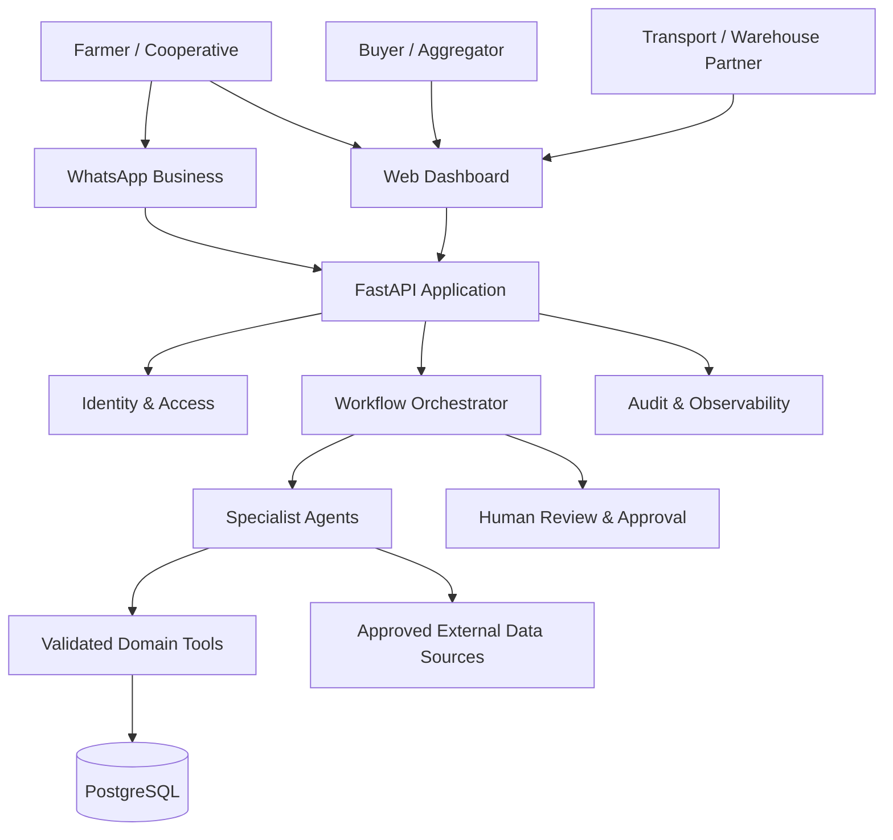

# HarvestLink AI — System Architecture

**Status:** Target architecture, version 1.0  
**Product:** Multi-agent agricultural supply-chain coordination platform  
**Initial market:** Nigeria; pilot geography can begin in Nasarawa State  
**Interfaces:** Web dashboard and WhatsApp Business  
**Architecture style:** Modular monolith first; independently deployable workers/services only when scale requires them.

## 1. Product outcome

HarvestLink helps farmers/cooperatives publish structured produce supply, helps buyers express demand, and coordinates trustworthy matches with price context, logistics and storage discovery. The product is not merely a chatbot: it plans a bounded workflow, selects specialist agents and deterministic tools, records evidence, handles failures, and asks a human to approve consequential actions.

## 2. System context



External systems are accessed only through explicit adapters. The MVP must work without any one external LLM, WhatsApp provider, market-data source or logistics partner.

## 3. Logical modules

1. **Identity & access:** users, organizations, memberships, roles, sessions/tokens and authorization.
2. **Marketplace:** crop catalogue, produce listings, buyer requirements, search and match candidates.
3. **Agent runtime:** orchestrator, specialist agents, tool registry, prompt/version registry, execution traces and task state.
4. **Market intelligence:** sourced market observations and price normalization.
5. **Coordination:** logistics and storage providers, service offers, quotations and availability records.
6. **Trust & transactions:** verification cases, moderation, approval requests, transaction terms, delivery milestones and disputes.
7. **Channels:** versioned REST API, dashboard and WhatsApp webhook/adapter.
8. **Platform operations:** configuration, migrations, background jobs, audit events, metrics, backups and CI/CD.

Keep these as Python packages/modules within one FastAPI deployment initially. Background tasks can use a worker queue when asynchronous workloads become necessary. Do not introduce microservices, Kubernetes or a vector database until a measured requirement justifies them.

## 4. Runtime workflow

1. Channel adapter authenticates the user/session and converts the incoming message or form into a canonical request.
2. API validates identity, organization scope, rate limits and request schema.
3. Orchestrator creates a workflow run and records the initiating event.
4. Orchestrator chooses a predefined workflow and delegates typed tasks to allowed specialist agents.
5. Agents use registered tools. Tools validate inputs, enforce authorization and perform deterministic database or adapter operations.
6. Each agent returns structured output, evidence references, confidence/limitations and a status—not free-form text alone.
7. Orchestrator checks required outputs, handles retries/timeouts and assembles a recommendation.
8. If an action is consequential, the system creates an approval request and waits. It does not execute the action merely because the LLM recommends it.
9. Approved action is executed by a deterministic service, with idempotency protection and an immutable audit event.
10. Channel adapter presents the result and next steps.

## 5. Agent execution contract

Every run has: `workflow_run_id`, `tenant/organization_id`, `actor_user_id`, `correlation_id`, `workflow_type`, `status`, timestamps, input/output schema versions, agent and model versions, tool-call records, evidence references, approval state and error summary.

Agent response envelope:

```json
{
  "agent": "buyer_matching",
  "status": "completed",
  "summary": "Two candidate requirements meet the hard constraints.",
  "data": {},
  "evidence_refs": [],
  "warnings": [],
  "confidence": 0.0,
  "requires_human_review": false
}
```

Confidence is an internal quality signal, not proof of truth. Evidence and validation rules take precedence.

## 6. Data and infrastructure

- **Primary database:** PostgreSQL in staging/production; SQLite for lightweight local tests only.
- **ORM/migrations:** SQLAlchemy 2 and Alembic. Schema changes are explicit migrations; production never creates tables automatically.
- **Cache/queue:** optional Redis for rate limiting, caching and background jobs when required.
- **File/object storage:** private object storage for verification documents and images; store metadata and access policy in PostgreSQL.
- **LLM provider:** adapter interface with provider-specific implementations; no business logic depends on one provider.
- **External integrations:** WhatsApp Business Platform, market-price sources, maps/routing, SMS/email, transporter/warehouse partner systems.
- **Deployment:** Docker image, environment-based config, CI checks and staged deployment. Keep secrets in deployment secret storage.

## 7. Reliability and failure handling

- Validate every LLM output against versioned Pydantic schemas.
- Treat model output, uploaded files, user text and external API responses as untrusted.
- Set per-agent timeouts, bounded retries and retry only safe/idempotent operations.
- Use idempotency keys for webhook processing, workflow creation and consequential commands.
- Persist workflow state so an interrupted run can resume or be marked for review.
- If market, logistics or storage data is unavailable, report unavailable; never invent an answer.
- If a specialist fails, return partial results with a clear warning or route to human review.
- Use optimistic concurrency/version checks for listings and transaction terms.
- Record source, retrieval time, units, location and freshness for changing data.

## 8. Security boundaries

- Every business record is scoped to an organization/tenant; every query and mutation enforces that scope.
- Roles are not trusted from client input. Public registration cannot create privileged roles.
- Agent tools execute under the initiating user's permissions and narrow service permissions.
- Agents cannot bypass authorization by issuing SQL or arbitrary network requests.
- Separate recommendation from execution. Approval is bound to an exact action payload/version and expires.
- No agent may independently authorize payments, release funds, accept contracts or alter verified identity.
- Protect webhook signatures, uploaded files, credentials and personally identifiable information.
- Maintain audit history for access to sensitive records and every consequential state transition.

## 9. Deployment topology

**MVP:** one FastAPI app, PostgreSQL, static/web dashboard, WhatsApp webhook adapter, and optional worker process. One repository and one deployment pipeline.

**Scale path:** split worker, channel adapters, search/indexing or integrations only when throughput, team ownership, availability or security isolation demands it. Preserve stable API and event contracts.

## 10. Architecture decision principles

1. Modular monolith before microservices.
2. Deterministic domain services before LLM autonomy.
3. Evidence-backed outputs before polished language.
4. Human approval before irreversible or binding actions.
5. Provider-neutral interfaces and portable data.
6. Observability and auditability from the first workflow.
7. Build the complete architecture once; implement vertical slices progressively.
